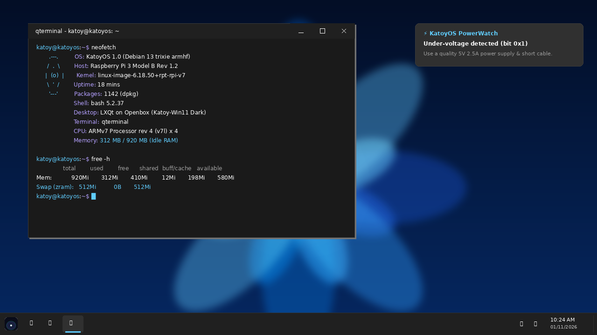
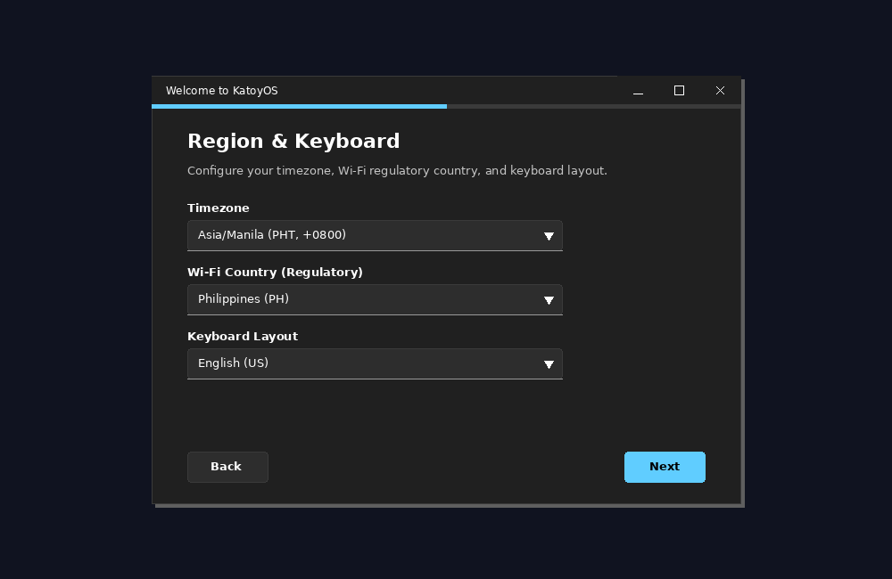

# KatoyOS

> **Tagline:** "Stable. Rapid. Resilient."

**KatoyOS** is a lightweight, modern, easy-to-use desktop operating system specifically engineered for the **Raspberry Pi 3 Model B (only)**, built on top of Debian 13 ("trixie") via Raspberry Pi OS tooling (`pi-gen`, 32-bit `armhf`).

---

## Preview

### 🖼️ Brand & System Artwork
<p align="center">
  
</p>

*The KatoyOS brand identity featuring the signature glowing circuit oyster with pearl, emblem of stability, speed, and resilience.*

### 🖥️ Windows 11 Style Desktop UI & LXQt Integration
<p align="center">
  
</p>

*The KatoyOS desktop interface: Windows 11 style dark desktop on LXQt and Openbox (X11), 48px taskbar with running app accent underline, custom clock format, DMZ-White cursor, procedural blue bloom wallpaper, flat Openbox titlebars, low idle RAM (~312 MB), and KatoyOS PowerWatch under-voltage notification toast.*

### 🚀 KatoyOS Welcome Wizard
<p align="center">
  
</p>

*First-boot 5-page setup wizard (`katoy-welcome`): Built in PyQt6 and styled with Windows 11 dark QSS (`katoy-win11.qss`), featuring top progress tracking for seamless timezone selection, Wi-Fi country code regulation, keyboard layout matching, and user account password management.*

---

## Product Overview & Key Features

KatoyOS delivers a responsive, zero-configuration out-of-the-box desktop experience while maximizing hardware performance and extending microSD card lifespan on Raspberry Pi 3 Model B devices.

### 🌟 Core Highlights
- **Targeted Hardware Efficiency:** Tailored exclusively for Raspberry Pi 3 Model B (Broadcom BCM2837, 1 GB RAM, 2.4 GHz Wi-Fi, Bluetooth 4.1, Ethernet over USB 2.0). Idle desktop memory target is under ~400 MB RAM.
- **Windows 11 Style Desktop:** LXQt on Openbox (X11) styled with a clean Windows 11 dark look: 48px taskbar (start button with KatoyOS logo, pinned apps, running apps with an accent underline, custom 12-hour clock over date), rounded menus and notifications, flat Openbox titlebars with thin glyphs and red close hover button, Papirus-Dark icons, Inter sans-serif typography, DMZ-White cursor, and an original blue bloom wallpaper. Built using solid colors so it requires no compositor, keeping GPU and CPU cycles free on the Pi 3B.
- **Zero-Config First Boot & Guided Welcome Wizard (`katoy-welcome`):** Automatically boots into a graphical LXQt desktop as user `katoy` and presents a 5-page wizard (PyQt6) allowing users to easily configure timezones, Wi-Fi country code, keyboard layouts, and set new account passwords.
- **Privilege Separation (`katoy-helper` + Polkit):** Administrative tasks configured in the Welcome wizard use a dedicated, strictly validated helper binary controlled by Polkit authorization policies (`os.katoy.helper`), avoiding the safety risks of running complex GUIs as root.
- **Hardware Watchdog (`katoy-powerwatch`):** Actively monitors hardware status registers (`/sys/devices/platform/soc/soc:firmware/get_throttled`) to issue desktop notifications upon detecting power supply drops (under-voltage) or soft thermal throttling.
- **Lightweight Web Browsing (`katoy-browser`):** Built-in browser using PyQt6 WebEngine with search fallback, styled with Windows 11 controls, with transparent fallback to Falkon.
- **HDMI & Display Reliability:** Configured with fake-KMS (`vc4-fkms-v3d`) and forced 1080p HDMI modes in `config.txt` to eliminate black screens and display sync issues on Raspberry Pi 3B hardware.
- **SD-Card Resilience:** System logs configured to RAM-only (`Storage=volatile` with `32M` ceiling in `journald`), combined with zram compressed swap (`rpi-swap`), significantly reducing physical flash wear.
- **Seamless Updates (`katoy-update` & Unattended Security Updates):** Includes a one-click graphical terminal updater alongside `unattended-upgrades` pre-configured for automated security patches.

---

## Technical Specifications

| Feature | Specification |
| --- | --- |
| **Base Distribution** | Debian 13 "trixie" (`armhf`, 32-bit userland) |
| **Kernel Target** | Raspberry Pi v7 kernel (`kernel7.img`, Cortex-A53 in 32-bit mode); non-v7 kernels pruned |
| **Display Server & WM** | X11 with Openbox window manager (`Katoy-Win11` theme) |
| **Desktop Environment** | LXQt (`katoy-win11` theme, Fusion style, Windows 11 dark palette in `lxqt.conf`, Papirus-Dark icons) |
| **Cursor Theme** | DMZ-White (`dmz-cursor-theme`, size 24) |
| **Fonts & Typography** | Inter font (`fonts-inter`), fontconfig alias mapping `Segoe UI` and `system-ui` to Inter |
| **Display Manager** | LightDM (`lightdm-gtk-greeter`) with auto-login as `katoy` |
| **Default User** | `katoy` (Initial password: `changeme` - prompted to change on first boot) |
| **Default Hostname** | `katoyos` |
| **Default Locale & Timezone** | `en_US.UTF-8`, Keyboard: `us`, Timezone: `UTC` |
| **Audio Stack** | PipeWire with WirePlumber and Pavucontrol-Qt |
| **Network Manager** | NetworkManager + `nm-tray` with `nmtui` integration |

---

## First Boot & Welcome Wizard

When KatoyOS boots for the first time:
1. **Oyster Plymouth Splash:** A dark-navy themed boot screen displays while the system initializes.
2. **Auto-Login:** Boots straight into the LXQt desktop without requiring password input.
3. **KatoyOS Welcome Wizard (`katoy-welcome`):** Automatically launches to assist with initial setup:
   - **Step 1 - Welcome:** Introduction and "Don't show this on startup" toggle.
   - **Step 2 - Network:** Wi-Fi connection guide with a direct button to launch `nmtui` network manager.
   - **Step 3 - Region & Keyboard:** Timezone picker, Wi-Fi regulatory country selector (`raspi-config nonint do_wifi_country`), and xkb keyboard layout selection.
   - **Step 4 - Password:** Account password changer for `katoy`.
   - **Step 5 - Finish:** Applies configured options via `katoy-helper` and marks setup complete.

---

## Custom KatoyOS Tools

- **`katoy-welcome`** (`/usr/bin/katoy-welcome`): PyQt6 setup wizard running on session startup until completed, styled with `katoy-win11.qss`.
- **`katoy-helper`** (`/usr/lib/katoyos/helper`): Privileged bash script invoked via Polkit (`pkexec`) for secure timezone, keyboard, Wi-Fi country, and password configuration.
- **`katoy-browser`** (`/usr/bin/katoy-browser`): Simple and responsive web browser with DuckDuckGo search fallback and Windows 11 tool styling, delegating to Falkon if `python3-pyqt6.qtwebengine` is absent.
- **`katoy-powerwatch`** (`/usr/bin/katoy-powerwatch`): Background daemon polling firmware throttling bits and notifying the user if power supply voltage drops or temperature limits are reached.
- **`katoy-update`** (`/usr/bin/katoy-update`): Graphical menu tool launching system package upgrade in `qterminal`.

---

## Build Instructions

Building KatoyOS produces a flashable `KatoyOS-*.img.xz` image from source using `pi-gen`.

### Prerequisites
- Host OS: Linux or WSL2 (Ubuntu 22.04/24.04 recommended, working inside the Linux filesystem, **not** `/mnt/c/`)
- Dependencies: Docker, `git`, `python3-pillow`, `qemu-user-static`, `binfmt-support`
- Disk Space: ~15-20 GB free space

### One-Command Build

```bash
./build.sh
```

`build.sh` automatically:
1. Clones the pinned `pi-gen` release tag (`2026-10-06-raspios-trixie-armhf`).
2. Generates all derived brand assets from `assets/katoyos-brand.png` via `tools/make-assets.py` (including the Windows 11 style blue bloom wallpaper).
3. Injects custom `stage-katoy` sub-stages (packages, branding, desktop, tools, Pi 3 tuning).
4. Patches `pi-gen` inode density settings (`mke2fs -i 8192`) to prevent rootfs inode exhaustion during desktop package installation.
5. Executes `./build-docker.sh` and exports compressed image artifacts to `./out/KatoyOS-*.img.xz`.

### CI/CD Build
A GitHub Actions workflow is provided in `.github/workflows/build.yml`. It runs automatically on version tags (`v*`) or manual `workflow_dispatch` triggers, producing downloadable build artifacts.

---

## Flashing KatoyOS

1. Download or locate `out/KatoyOS-*.img.xz`.
2. Open [Raspberry Pi Imager](https://www.raspberrypi.com/software/).
3. Choose **OS** -> **Use Custom** and select your `KatoyOS-*.img.xz` file.
4. Select your target microSD card and click **Write**.
5. Insert the microSD card into your **Raspberry Pi 3 Model B** and power on!

---

## Repository Layout

```
katoyos/
├── README.md                                    # Product overview, previews, build & flash guide
├── LICENSE                                      # MIT License
├── config                                       # pi-gen build configuration
├── build.sh                                     # Automated Docker-based build script
├── assets/
│   ├── katoyos-brand.png                        # Original 1024x572 branding canvas
│   ├── katoyos-desktop-preview.png              # Windows 11 style desktop preview screenshot
│   └── katoyos-welcome-preview.png              # Welcome wizard preview screenshot
├── tools/
│   ├── make-assets.py                           # Derives wallpaper bloom, splash, and icons
│   ├── make-ui-previews.py                      # Generates desktop and wizard documentation previews
│   └── test-stage.sh                            # Dry-run stage verification test harness
├── docs/
│   ├── DECISIONS.md                             # Architectural and design decision records
│   └── BUILDING.md                              # Build requirements & WSL2 instructions
├── .github/
│   └── workflows/build.yml                      # GitHub Actions automated CI workflow
└── stage-katoy/                                 # Custom pi-gen build stage
    ├── EXPORT_IMAGE
    ├── prerun.sh
    ├── 00-packages/                             # Package lists & optional install scripts
    ├── 01-branding/                             # Wallpaper, Plymouth theme, release metadata
    ├── 02-desktop/                              # LXQt & Openbox Windows 11 themes, greeter, GTK, fonts
    │   └── files/
    │       ├── lxqt-theme/                      # katoy-win11 QSS stylesheets (panel, runner, notification)
    │       ├── openbox-theme/                   # Katoy-Win11 themerc and XBM caption buttons
    │       ├── 60-katoy-fonts.conf              # Inter and Segoe UI fontconfig aliasing
    │       ├── greeter.conf                     # LightDM GTK greeter styling
    │       ├── gtk-settings.ini                 # GTK3 dark theme & DMZ-White cursor settings
    │       ├── lxqt.conf                        # LXQt theme, icon theme, and Qt dark palette
    │       ├── panel.conf                       # 48px panel layout, quicklaunch, taskbar, clock
    │       └── pcmanfm-settings.conf            # PCManFM-Qt desktop wallpaper & colors
    ├── 03-tools/                                # Built-in utilities, policies, and launchers
    │   └── files/
    │       ├── katoy-browser                    # Lightweight web browser with search fallback
    │       ├── katoy-welcome                    # 5-page setup wizard with progress tracking
    │       ├── katoy-helper                     # Privileged system settings backend
    │       ├── katoy-powerwatch                 # Hardware under-voltage & throttling watchdog
    │       ├── katoy-update                     # Graphical system updater launcher
    │       ├── os.katoy.helper.policy           # Polkit privilege separation policy
    │       └── win11/                           # Shared Windows 11 QSS stylesheet and icons
    └── 04-pi3/                                  # config.txt (fake-KMS), cmdline.txt, volatile journald, kernel pruning
```

---

## Status & Verification

All scripts in KatoyOS are strictly validated with `bash -n`, `python3 -m py_compile`, and `./tools/test-stage.sh` dry-run assertions:
- **Dry-run stage assertions:** Passed
- **Asset generator pipeline:** Passed
- **Theme integration & panel configs:** Passed
- **Helper input validation tests:** Passed
- **Build script Docker integration:** Verified
