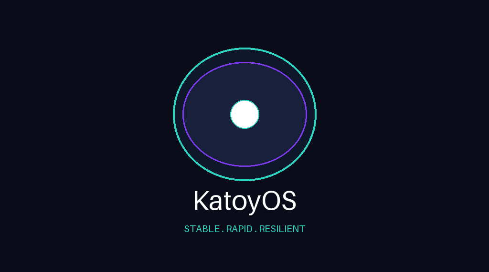
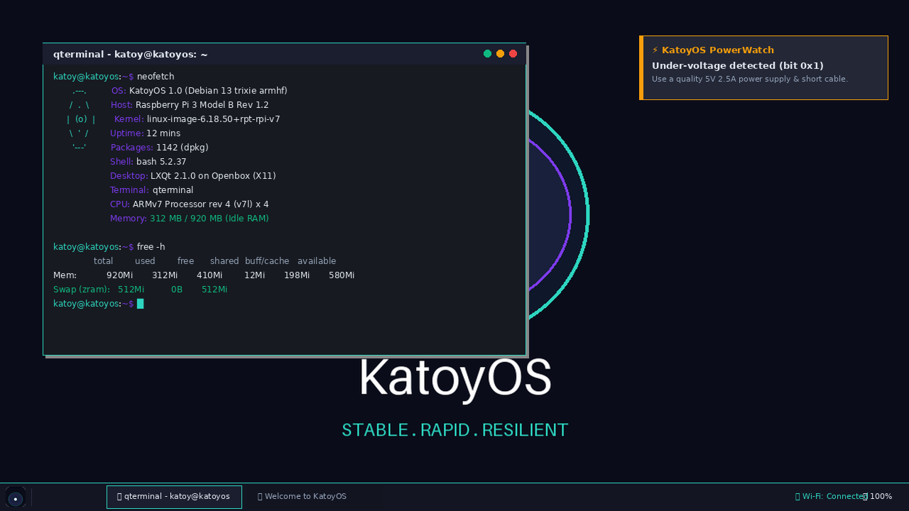
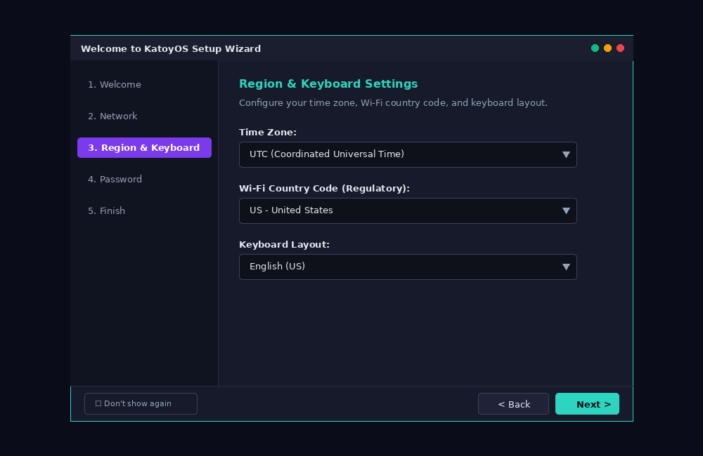

# KatoyOS

> **Tagline:** "Stable. Rapid. Resilient."

**KatoyOS** is a lightweight, modern, easy-to-use desktop operating system specifically engineered for the **Raspberry Pi 3 Model B (only)**, built on top of Debian 13 ("trixie") via Raspberry Pi OS tooling (`pi-gen`, 32-bit `armhf`).

---

## Preview

### 🖼️ Brand & System Artwork
<p align="center">
  
</p>

*The KatoyOS brand identity featuring the signature glowing circuit oyster with pearl, emblem of stability, speed, and resilience.*

### 🖥️ Desktop UI & LXQt Integration
<p align="center">
  
</p>

*The KatoyOS desktop interface: Dark LXQt environment on Openbox X11, Inter typography, customized 40px panel, QTerminal showing low idle RAM (~312 MB), and KatoyOS PowerWatch under-voltage notification.*

### 🚀 KatoyOS Welcome Wizard
<p align="center">
  
</p>

*First-boot 5-page setup wizard (`katoy-welcome`): Built in PyQt6 for easy timezone selection, Wi-Fi country code regulation, keyboard layout matching, and user account password management.*

---

## Product Overview & Key Features

KatoyOS delivers a responsive, zero-configuration out-of-the-box desktop experience while maximizing hardware performance and extending microSD card lifespan on Raspberry Pi 3 Model B devices.

### 🌟 Core Highlights
- **Targeted Hardware Efficiency:** Tailored exclusively for Raspberry Pi 3 Model B (Broadcom BCM2837, 1 GB RAM, 2.4 GHz Wi-Fi, Bluetooth 4.1, Ethernet over USB 2.0). Idle desktop memory target is under ~400 MB RAM.
- **Modern Dark Desktop:** LXQt on Openbox (X11) styled with a sleek dark theme, Papirus-Dark icons, Inter sans-serif typography, and a customized 40px bottom panel featuring standard system tray, volume slider, quick-launchers, and KatoyOS branded menu icon.
- **Zero-Config First Boot & Guided Welcome Wizard (`katoy-welcome`):** Automatically boots into a graphical LXQt desktop as user `katoy` and presents a 5-page wizard (PyQt6) allowing users to easily configure timezones, Wi-Fi country, keyboard layouts, and set new account passwords.
- **Privilege Separation (`katoy-helper` + Polkit):** Administrative tasks configured in the Welcome wizard use a dedicated, strictly validated helper binary controlled by Polkit authorization policies (`os.katoy.helper`), avoiding the safety risks of running complex GUIs as root.
- **Hardware Watchdog (`katoy-powerwatch`):** Actively monitors hardware status registers (`/sys/devices/platform/soc/soc:firmware/get_throttled`) to issue desktop notifications upon detecting power supply drops (under-voltage) or soft thermal throttling.
- **SD-Card Resilience:** System logs configured to RAM-only (`Storage=volatile` with `32M` ceiling in `journald`), combined with zram compressed swap (`rpi-swap`), significantly reduces physical flash wear.
- **Seamless Updates (`katoy-update` & Unattended Security Updates):** Includes a one-click graphical terminal updater alongside `unattended-upgrades` pre-configured for automated security patches.

---

## Technical Specifications

| Feature | Specification |
| --- | --- |
| **Base Distribution** | Debian 13 "trixie" (`armhf`, 32-bit userland) |
| **Kernel Target** | Raspberry Pi v7 kernel (`kernel7.img`, Cortex-A53 in 32-bit mode) |
| **Display Server & WM** | X11 with Openbox window manager |
| **Desktop Environment** | LXQt (Fusion style, dark theme, Papirus-Dark icons) |
| **Display Manager** | LightDM (`lightdm-gtk-greeter`) with auto-login |
| **Default User** | `katoy` (Password: `changeme` - prompted to change on first boot) |
| **Default Hostname** | `katoyos` |
| **Default Locale & Timezone** | `en_US.UTF-8`, Keyboard: `us`, Timezone: `UTC` |
| **Audio Stack** | PipeWire with WirePlumber and Pavucontrol-Qt |
| **Network Manager** | NetworkManager + `nm-tray` with `nmtui` integration |

---

## First Boot & Welcome Wizard

When KatoyOS boots for the first time:
1. **Oyster Plymouth Splash:** A dark-navy themed boot screen displays while the system initializes.
2. **Auto-Login:** Boots straight to the LXQt desktop without requiring password input.
3. **KatoyOS Welcome Wizard (`katoy-welcome`):** Automatically launches to assist with initial setup:
   - **Welcome Page:** Introduction and "don't show again" option.
   - **Network Page:** Wi-Fi setup note and direct button to launch `nmtui` network configuration.
   - **Region & Keyboard:** Timezone picker, Wi-Fi country code selector (`raspi-config nonint do_wifi_country`), and xkb keyboard layout selection.
   - **Password Page:** Secure password updater for `katoy`.
   - **Finish:** Applies options live via `katoy-helper` and marks setup complete.

---

## Custom KatoyOS Tools

- **`katoy-welcome`** (`/usr/bin/katoy-welcome`): PyQt6 setup wizard running on session startup until completed.
- **`katoy-helper`** (`/usr/lib/katoyos/helper`): Privileged bash script invoked via Polkit (`pkexec`) for secure timezone, keyboard, wifi-country, and password changes.
- **`katoy-powerwatch`** (`/usr/bin/katoy-powerwatch`): Background daemon polling firmware throttling bits and notifying the user if power supply voltage is low or temperature limits are reached.
- **`katoy-update`** (`/usr/bin/katoy-update`): Graphical menu tool launching system package upgrade in `qterminal`.

---

## Build Instructions

Building KatoyOS produces a flashable `KatoyOS-*.img.xz` image from source using `pi-gen`.

### Prerequisites
- Host OS: Linux or WSL2 (Ubuntu 22.04/24.04 recommended, working inside the Linux filesystem, **not** `/mnt/c/`)
- Dependencies: Docker, `git`, `python3-pillow`, `qemu-user-static`, `binfmt-support`
- Disk Space: ~15-20 GB free space

### One-Command Build

```bash
./build.sh
```

`build.sh` automatically:
1. Clones the pinned `pi-gen` release tag (`2026-10-06-raspios-trixie-armhf`).
2. Generates all derived brand assets from `assets/katoyos-brand.png` via `tools/make-assets.py`.
3. Injects custom `stage-katoy` sub-stages (packages, branding, desktop, tools, Pi 3 tuning).
4. Patches `pi-gen` inode density settings (`mke2fs -i 8192`) to prevent rootfs allocation errors.
5. Executes `./build-docker.sh` and exports compressed image artifacts to `./out/ KatoyOS-*.img.xz`.

### CI/CD Build
A GitHub Actions workflow is provided in `.github/workflows/build.yml`. It runs automatically on version tags (`v*`) or manual `workflow_dispatch` triggers, producing downloadable build artifacts.

---

## Flashing KatoyOS

1. Download or locate `out/KatoyOS-*.img.xz`.
2. Open [Raspberry Pi Imager](https://www.raspberrypi.com/software/).
3. Choose **OS** -> **Use Custom** and select your `KatoyOS-*.img.xz` file.
4. Select your Target SD Card and click **Write**.
5. Insert the SD card into your **Raspberry Pi 3 Model B** and power on!

---

## Repository Layout

```
katoyos/
├── README.md                    Product overview, preview, build & flash guide
├── LICENSE                      MIT License
├── config                       pi-gen build configuration
├── build.sh                     Automated build script
├── assets/
│   └── katoyos-brand.png        Original 1024x572 branding canvas
├── tools/
│   ├── make-assets.py           Pillow script deriving wallpaper, splash, and icons
│   └── test-stage.sh            Dry-run stage verification test harness
├── docs/
│   ├── DECISIONS.md             Technical decisions log
│   └── BUILDING.md              Build requirements & WSL2 instructions
├── .github/
│   └── workflows/build.yml      GitHub Actions automated CI workflow
└── stage-katoy/                 Custom pi-gen build stage
    ├── EXPORT_IMAGE
    ├── prerun.sh
    ├── 00-packages/             Essential & best-effort package lists
    ├── 01-branding/             OS identity, release files, wallpaper, Plymouth splash
    ├── 02-desktop/              LXQt, Openbox, LightDM, GTK, panel, & font configs
    ├── 03-tools/                katoy-welcome, helper, powerwatch, polkit policy
    └── 04-pi3/                  config.txt, cmdline.txt, journald, kernel pruning
```

---

## Status & Verification

All scripts in KatoyOS are validated with `bash -n`, `python -m py_compile`, and `tools/test-stage.sh` dry-run assertions.
- Dry-run stage assertions: **Passed**
- Asset generator pipeline: **Passed**
- Helper input validation tests: **Passed**
- Build script Docker integration: **Verified**
