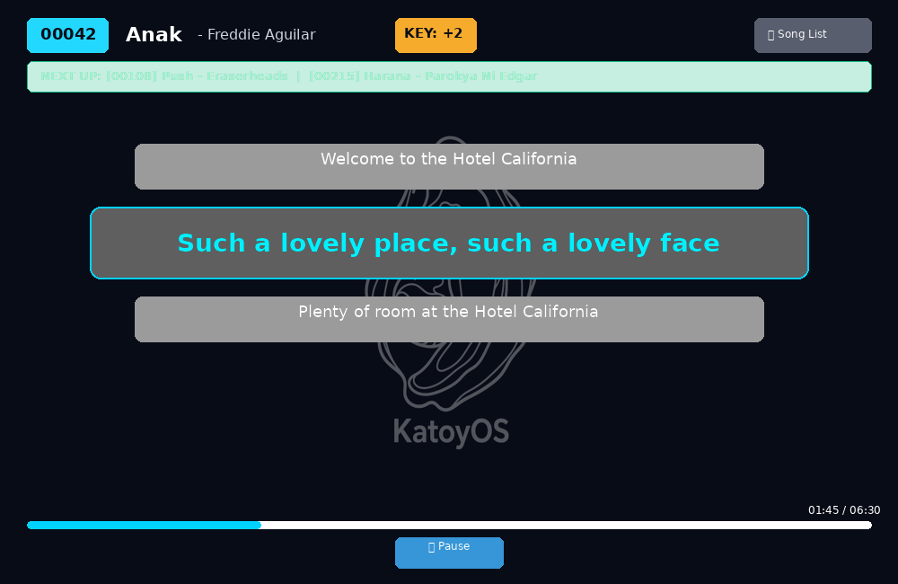
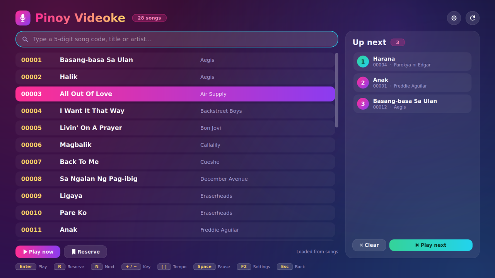

# KatoyOS — KaraOkePi Appliance

> **Tagline:** "Stable. Rapid. Resilient."

**KatoyOS is a dedicated karaoke appliance for the Raspberry Pi 3 Model B.** With the default build setting `KATOY_KIOSK=1`, power on the device, see the KatoyOS Plymouth splash, and go straight into the fullscreen **KaraOkePi** player — no desktop or display manager to navigate. An optional LXQt desktop image is still available by setting `KATOY_KIOSK=0` in `config`.

Built on Debian 13 ("trixie") using Raspberry Pi OS tooling (`pi-gen`) and a 32-bit `armhf` userspace, KatoyOS is designed to turn a Raspberry Pi 3 Model B into a simple, purpose-built Pinoy karaoke system.

---

## Preview

### 🎤 Default Interface — KaraOkePi

The default `KATOY_KIOSK=1` image boots directly into the fullscreen KaraOkePi player. The screenshots below are the existing player/library previews; fresh captures from a built image or Raspberry Pi 3B are **pending** and should be added after on-device verification.

<p align="center">
  
</p>

*Existing player preview — refresh this capture from the current default kiosk image.*

<p align="center">
  
</p>

*Existing song-library preview — refresh this capture from the current default kiosk image.*

> **Fresh screenshots pending:** This session has no Raspberry Pi 3B device or runnable pi-gen build environment, so no new player, library, or boot-splash screenshots have been fabricated. The legacy LXQt desktop and Welcome Wizard screenshots have been removed because they do not represent the default kiosk experience. No Welcome Wizard is launched in kiosk mode.

### 🖼️ KatoyOS Brand Artwork

<p align="center">
  
</p>

*The KatoyOS identity: a glowing circuit oyster with pearl, representing stability, speed, and resilience.*

---

## Product Overview

### 🎤 KaraOkePi — the default appliance experience

KatoyOS is built to behave like a karaoke machine, not a general-purpose desktop computer. The default boot path is:

`Power on → Plymouth splash → katoy-karaoke.service → fullscreen KaraOkePi player`

- **Direct kiosk startup:** `katoy-karaoke.service` starts from `multi-user.target` on tty1. It creates a real PAM/logind login session for the `katoy` user and launches X11 through `xinit`, followed by the KaraOkePi launcher and player.
- **No display manager:** Kiosk mode does not use LightDM or a graphical login screen.
- **Automatic recovery:** systemd restarts the player if it exits. If repeated startup failures reach the service start limit, `OnFailure` hands tty1 back to `getty` for a login prompt.
- **Maintenance access:** Use TTY2 (`Ctrl+Alt+F2`) for a local maintenance shell. SSH is disabled in the default build; enable it manually if remote administration is needed.
- **Karaoke data partition:** A dedicated FAT32 `KATOYDATA` partition stores songs, SoundFonts, and background graphics. It expands on first boot to use the remaining SD-card space, while the root filesystem remains at its image size.

### KaraOkePi features

- **MIDI/KAR playback:** Fullscreen PyQt6 player powered by FluidSynth and PipeWire audio synthesis.
- **Synced lyrics:** Reads MIDI lyric meta-events and highlights lyrics in time with playback.
- **Song reservation queue:** Queue upcoming songs and display the next singer/song banner.
- **Performance controls:** Key/pitch transpose, tempo adjustment, and end-of-song scoring.
- **Microphone and audio routing:** Low-latency microphone monitoring, separate mic/music volume controls, and output selection for HDMI, 3.5 mm audio, or USB DAC.
- **Phone remote and Wi-Fi onboarding:** A mobile-friendly LAN interface at `http://<pi-ip>:8080`, with an idle-screen QR code. If Wi-Fi is unavailable, the player can bring up a NetworkManager setup hotspot.
- **USB library support:** Automatically scans removable USB drives for songs, SoundFonts (`.sf2`), and background graphics.
- **SD-card friendly library:** The SQLite song database can live on the USB drive, avoiding routine database writes to the system SD card.
- **Cascading configuration:** In-player settings and USB-root `.katoy-karaoke.conf` overrides allow appliance customization.

### Optional LXQt desktop build

A traditional desktop variant remains available for users who want a general-purpose graphical environment. Set `KATOY_KIOSK=0` in `config` before building.

The optional desktop image uses:
- **LXQt on Openbox/X11**, with a dark theme, Papirus-Dark icons, Inter typography, and a customized panel.
- **LightDM auto-login** for the `katoy` account.
- **KatoyOS Welcome Wizard (`katoy-welcome`):** a PyQt6 first-run setup flow for timezone, Wi-Fi country, keyboard layout, and password configuration.
- **Desktop utilities:** KatoyOS PowerWatch notifications and the graphical `katoy-update` launcher.

These desktop components are not the default user interface when `KATOY_KIOSK=1`.

### Shared system features

- **Raspberry Pi 3 Model B tuning:** Targets the BCM2837 platform with 1 GB RAM, Wi-Fi, Bluetooth, and Ethernet.
- **Hardware PowerWatch:** Monitors firmware throttling flags and can report under-voltage or thermal-throttling events.
- **Reduced SD-card wear:** Journald is configured for volatile RAM storage with a 32 MB runtime limit; zram swap is provided by the base system.
- **System updates:** The `katoy-update` tool provides an on-demand package update path.

---

## Technical Specifications

| Feature | Specification |
| --- | --- |
| **Base Distribution** | Debian 13 "trixie" (`armhf`, 32-bit userland) |
| **Hardware Target** | Raspberry Pi 3 Model B |
| **Kernel Target** | Raspberry Pi v7 kernel (`kernel7.img`, 32-bit mode) |
| **Default UI / Boot Mode** | KaraOkePi fullscreen kiosk (`KATOY_KIOSK=1`) |
| **Display Manager** | None (kiosk boots via `katoy-karaoke.service` on tty1) |
| **Display Server** | X11 via `xinit` (no WM in kiosk mode; Openbox + LXQt only in desktop build) |
| **Optional Desktop** | LXQt + Openbox + LightDM (`KATOY_KIOSK=0`) |
| **Default User** | `katoy` (created at build time) |
| **Default Hostname** | `katoyos` |
| **Default Locale & Timezone** | `en_US.UTF-8`, keyboard: `us`, timezone: `UTC` |
| **SSH** | Disabled by default (`ENABLE_SSH=0`); enable manually when required |
| **Audio Stack** | PipeWire / WirePlumber with FluidSynth for karaoke playback |
| **Network** | NetworkManager |
| **Read-only Root** | Optional `KATOY_OVERLAYFS=1` enables OverlayFS; default is `0` in `config` |
| **Pi 3 Display Driver** | `KATOY_FKMS=1` selects `vc4-fkms-v3d`; set to `0` for stock full-KMS `vc4-kms-v3d` |

---

## First Boot & Maintenance

### Default kiosk image (`KATOY_KIOSK=1`)

1. **Power on:** The device displays the KatoyOS Plymouth splash while Linux starts.
2. **Player startup:** systemd starts `katoy-karaoke.service` on tty1. The service opens the `katoy` PAM session, starts X11 with `xinit`, and launches the fullscreen KaraOkePi player.
3. **Maintenance:** Press `Ctrl+Alt+F2` to switch to TTY2 for a local shell. Return to the player on tty1 with `Ctrl+Alt+F1`. SSH is off by default and must be enabled manually.

There is no LightDM auto-login screen or Welcome Wizard in the default kiosk flow.

### Optional desktop image (`KATOY_KIOSK=0`)

The desktop variant enables LightDM auto-login into LXQt and can launch the `katoy-welcome` wizard. The wizard provides:
- **Welcome:** Introduction and a "don't show again" option.
- **Network:** Wi-Fi setup guidance and a shortcut to `nmtui`.
- **Region & Keyboard:** Timezone, Wi-Fi country, and keyboard layout settings.
- **Password:** A password update flow for the `katoy` account.
- **Finish:** Applies settings through the privileged `katoy-helper` and marks setup complete.

This wizard description applies only to the optional desktop build.

---

## No Package-Configuration Dialogs

KatoyOS configures package management to avoid interactive package-configuration dialogs during normal appliance operation and updates:

- **Debconf frontend:** The Pi 3 stage sets debconf to `Noninteractive` and critical priority.
- **Safe configuration-file handling:** APT's `90katoy-noninteractive` configuration sets `--force-confdef` and `--force-confold` for dpkg configuration files.
- **Background package services:** apt daily services and timers, PackageKit, apt-listchanges units, and related automatic package activity are masked.
- **Unattended upgrades:** `unattended-upgrades` is purged from the image.
- **Build-time package check:** The image build runs `dpkg --configure -a` and checks for packages left in an incomplete configuration state.
- **Package-operation trace:** The `katoy-apt-trace` hook records the process chain that invoked apt/dpkg. Its log is written to `/boot/firmware/katoy-apt-trace.log` when that partition is writable (otherwise it falls back to `/var/log/katoy-apt-trace.log`).

These controls cover the package-management paths configured by KatoyOS; they do not prevent an unrelated application from displaying its own custom graphical interface.

---

## Custom KatoyOS Tools

- **`katoy-karaoke`** (`/usr/bin/katoy-karaoke`): Fullscreen PyQt6 Pinoy videoke MIDI/KAR player.
- **`katoy-karaoke-launcher`** (`/usr/bin/katoy-karaoke-launcher`): Prepares and launches the player session.
- **`katoy-karaoke-session`** (`/usr/bin/katoy-karaoke-session`): Session support for the karaoke appliance.
- **`katoy-karaoke.service`** (`/etc/systemd/system/katoy-karaoke.service`): Starts and supervises the tty1 kiosk session.
- **`katoy-expand-data`** (`/usr/bin/katoy-expand-data`): Expands the dedicated karaoke data partition on first boot.
- **`katoy-update`** (`/usr/bin/katoy-update`): On-demand system package updater.
- **`katoy-helper`** (`/usr/lib/katoyos/helper`): Privileged helper used by supported desktop setup actions.
- **`katoy-powerwatch`** (`/usr/bin/katoy-powerwatch`): Monitors Raspberry Pi firmware throttling status.
- **`katoy-welcome`** (`/usr/bin/katoy-welcome`): First-run setup wizard for the optional desktop build.
- **`katoy-apt-trace`** (`/usr/lib/katoyos/apt-trace`): Logs apt/dpkg process ancestry for troubleshooting.

KaraOkePi settings are stored in `/etc/katoyos/karaoke.conf`. Supported settings include song directories (`SONGS_DIR`), SoundFont locations (`SOUNDFONT`), background images (`BACKGROUND`), audio driver, fullscreen mode, kiosk behavior, and Wi-Fi hotspot timing.

---

## Build Instructions

Building KatoyOS produces a flashable `KatoyOS-*.img.xz` image from source using `pi-gen`.

### Prerequisites

- **Host OS:** Linux or WSL2 (Ubuntu 22.04/24.04 recommended; work inside the Linux filesystem, not `/mnt/c/`).
- **Dependencies:** Docker, `git`, `python3-pillow`, `qemu-user-static`, and `binfmt-support`.
- **Disk space:** Approximately 15–20 GB free.

### One-Command Build

```bash
./build.sh
```

`build.sh` automatically:
1. Clones the pinned `pi-gen` release tag (`2026-10-06-raspios-trixie-armhf`).
2. Uses the brand assets committed in `stage-katoy/01-branding/files/`; `tools/make-assets.py --force` regenerates them from `assets/katoyos-brand.png`.
3. Injects the custom `stage-katoy` sub-stages for packages, branding, desktop support, tools, and Raspberry Pi 3 tuning.
4. Applies the configured pi-gen inode-density adjustment (`mke2fs -i 8192`).
5. Runs `./build-docker.sh` and exports compressed image artifacts to `./out/KatoyOS-*.img.xz`.

The default `config` builds the karaoke appliance. To build the optional LXQt desktop instead, change `KATOY_KIOSK=1` to `KATOY_KIOSK=0` before running the build.

### CI/CD Build

A GitHub Actions workflow is provided in `.github/workflows/build.yml`. It runs on version tags (`v*`) or manual `workflow_dispatch` triggers and produces downloadable build artifacts.

---

## Flashing KatoyOS

1. Download or locate `out/KatoyOS-*.img.xz`.
2. Open [Raspberry Pi Imager](https://www.raspberrypi.com/software/).
3. Choose **OS → Use Custom** and select the `KatoyOS-*.img.xz` file.
4. Select the target SD card and click **Write**.
5. Insert the SD card into your **Raspberry Pi 3 Model B** and power it on.

---

## Repository Layout

```
katoyos/
├── README.md                         Appliance overview, previews, build & flash guide
├── LICENSE                           MIT License
├── config                            pi-gen build configuration (KATOY_KIOSK=1 by default)
├── build.sh                          Automated build script
├── katoyos-blackscreen-fix.patch     Raspberry Pi display/black-screen fix
├── katoyos-boot-and-ui.patch         Boot and UI integration patch
├── katoyos-fkms-incremental.patch    FKMS-related incremental patch
├── assets/
│   ├── katoyos-brand.png
│   ├── katoyos-karaoke-preview.png
│   ├── katoyos-karaoke-library-preview.png
│├── tools/
│   ├── make-assets.py                Branding asset generator
│   └── test-stage.sh                 Stage verification test harness
├── docs/
│   ├── DECISIONS.md                  Technical decisions log
│   └── BUILDING.md                   Build requirements & WSL2 instructions
├── .github/
│   └── workflows/build.yml           GitHub Actions build workflow
└── stage-katoy/
    ├── EXPORT_IMAGE
    ├── prerun.sh
    ├── 00-packages/                  Base and optional package lists
    ├── 01-branding/                  OS identity, artwork, Plymouth splash
    ├── 02-desktop/                   Optional LXQt, Openbox, LightDM configuration
    ├── 03-tools/
    │   ├── 00-run.sh                 Installs appliance and desktop support tools
    │   └── files/
    │       ├── katoy-karaoke
    │       ├── katoy-karaoke-launcher
    │       ├── katoy-karaoke-session
    │       ├── katoy-karaoke.service
    │       ├── katoy-update
    │       ├── katoy-helper
    │       ├── katoy-apt-trace
    │       ├── katoy-welcome
    │       ├── katoy-powerwatch
    │       └── 90katoy-noninteractive
    └── 04-pi3/                       Pi 3 boot, display, package, and system tuning
```

---

## Status & Verification

The repository includes shell syntax checks, Python compilation checks, and the `tools/test-stage.sh` dry-run test harness. Run the checks locally before producing or distributing a new image.

Hardware-specific behavior — including display output, audio devices, USB song discovery, and optional OverlayFS operation — should be verified on the target Raspberry Pi 3 Model B before deployment.
